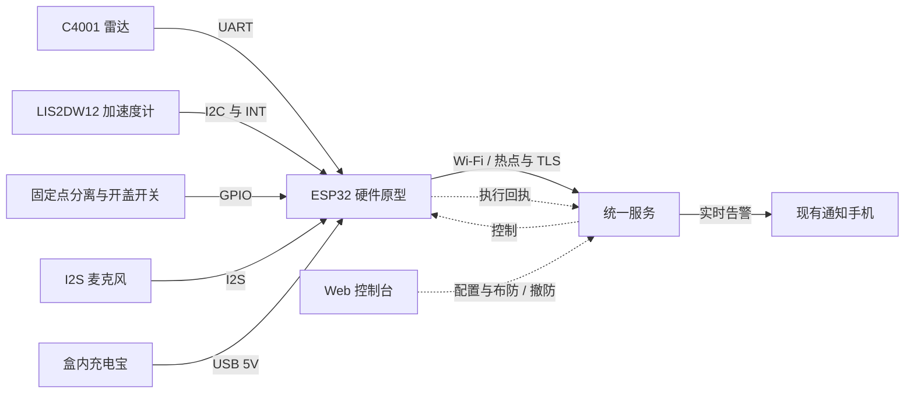

# 硬件原型设计与采购

负责：室外硬件原型的设计草案、采购清单、预算与选型条件。不负责：已交付功能、任务进度或验证证据。更新时机：owner 确认需求、器件或预算变化时。

## 目标与范围

状态：短期不再推进（owner 2026-10-10 确认），采购与设计条件保留，启动时间见[路线图](05-路线图.md)；以下目标、清单与设计仍是当前口径。

目标：室外固定监测 25 米级开阔面内人或骑行者经过，同时具备防拿走与突发大声 / 撞击告警，预算不超过 500 元，复用现有 Wi-Fi / 手机热点、服务器和通知手机。距离目标按已选 25m 版雷达的标称上限设定，稳定检出距离由现场实测确定，不是承诺值；它只作用于雷达经过检测，防拿走针对设备本体与安装点，麦克风只覆盖设备周边，两者都不随 25 米放大。首轮采用雷达＋三轴加速度计＋固定点分离开关＋数字麦克风，共用 ESP32 与成品充电宝；先测各路覆盖、误漏报和耗电，再确定长期使用组合。实施顺序是先跑通单雷达从采集、上报到控制台与通知的完整链路，再按实测结果决定是否加第二路雷达或第二个节点。这里只规划采购；硬件驱动与实际接入尚未实施。低成本多点位备选方向见文末一节，不计入本轮预算。

## 采购清单

2026-10-09 核对的官方标价与配件预算如下；配件金额是采购预留，不是商家报价，运费从余量支付；排针由 owner 自焊，不再预留代焊费，已有物品直接复用。

| 物品 | 数量 | 型号或下单条件 | 金额（元） |
|---|---|---|---|
| 主雷达 | 1 | [DFRobot C4001，SEN0609，25m、UART 版](https://www.dfrobot.com.cn/goods-3851.html)；排针自焊，确认随附 5Pin 排针，不混买 12m / I2C 版 | 官方标价 99 |
| Wi-Fi 开发板 | 1 | [FireBeetle 2 ESP32-E，DFR0654-F，预焊排母版](https://www.dfrobot.com.cn/goods-3048.html)；用于读雷达与联网，不承担视觉推理 | 官方标价 70 |
| 搬动 / 倾斜传感器 | 1 | [Fermion LIS2DW12 三轴加速度计，SEN0405，Breakout 版](https://mall.dfrobot.com.cn/goods-3186.html)；排针自焊，刚性固定在整机上；引出 I2C 和 INT 中断脚 | 官方标价 26 |
| 固定点分离 / 开盖开关 | 2 | 低压干接点防拆开关，各用于安装点分离和开盖；按结构接成“安装完好时闭合，拆下 / 开盖 / 断线时断开”，触发基准留在固定物上；确认微小电流可靠及户外密封 | 合计预留 10–20 |
| 数字麦克风 | 1 | [I2S 麦克风模块，SEN0327](https://www.dfrobot.com.cn/goods-2567.html)；3.3V 供电，排针自焊；读取声音幅度、峰值与背景变化 | 官方标价 15 |
| 麦克风防风 / 防水材料 | 1 套 | 防风海绵与声学透声防水膜，配向下的拾音口；按装机后的衰减重新测阈值 | 预留 5–10 |
| 成品电池电源 | 1 | 10000mAh 充电宝，5V / 2A USB 输出；确认能维持本原型的持续负载，不能依赖会定时退出的低电流模式；电源与控制板放在同一防拆盒内 | 预留 60–90 |
| USB 功率计 | 1 | 与充电宝输出口匹配，支持电压 / 电流及 Wh 累计；用于实测整机平均功率和可用能量 | 预留 25–35 |
| 塑料防水盒及密封件 | 1 套 | 标称 IP65 ABS 盒，乳白 / 白色料优先，非金属雷达前壁；内尺寸约 160×110×70mm 起，按实购充电宝核对；含遮阳挡雨件与盒内隔热棉；电池在盒内、整机无外接线缆，不需要出线密封件 | 预留 30–45 |
| 接线与下载材料 | 1 套 | 2.54mm 杜邦线、排针 / 排母条、紧固端子 / 固定底板、热缩管、USB-A 转 USB-C 数据线；包含 I2C、I2S、开关回路及运动中断接线，室外装机后固定接头 | 预留 25–40 |
| 安装材料 | 1 套 | 墙面底板（ABS / POM，胶粘）、MS 聚合物或免钉胶、滑轨与弹簧卡舌、防拆螺丝、防坠钢丝与既有固定物连接件、绝缘柱与螺丝；不用金属底板，避免金属进入雷达波束或天线背面 | 预留 25–45 |
| 原型物料合计 | | 不含已有电脑、热点手机、服务器及通知手机，也不含下方一次性焊接工具 | **390–495** |

保留 5–110 元机动费用（按上沿采购时运费余地很小，实际按接近下沿的配置下单）；原型物料下单含运费不得超过 500 元，焊接工具按下表按最低配一次性投入（120–280 元）、不挤进这 500 元。万用表、家用螺丝刀与充电宝优先复用；没有工具时选择配件预算下沿。第一轮暂不买第二路雷达、屏幕、蜂鸣器、摄像头、4G、太阳能、裸电芯或定制 PCB；通知复用现有手机。

### 焊接与工具（一次性投入）

排针与接头自己焊，本轮按最低配只买必需六件；金额是采购预留，不是商家报价。

| 工具 | 数量 | 型号或下单条件 | 金额（元） |
|---|---|---|---|
| 可调温电烙铁 | 1 | 60W 级带温控的数显烙铁或入门焊台，配尖头与刀头、清洁球 / 海绵 | 60–150 |
| 焊锡丝 | 1 卷 | 0.6–0.8mm 含松香细焊锡，用于 2.54mm 排针与导线 | 15–30 |
| 助焊剂 | 1 套 | 松香或助焊笔，配清洁用酒精片；不用强腐蚀性焊膏 | 5–15 |
| 吸锡器与吸锡带 | 1 套 | 拆焊与修正焊点，排针焊歪时必需 | 10–25 |
| 镊子 | 1 套 | 直头与弯头，夹持排针与细线 | 10–20 |
| 斜口钳与剥线钳 | 1 套 | 剪脚与剥线；没有剥线钳时用斜口钳替代 | 20–40 |
| 工具小计 | | 本轮最低配，只买上表六件 | **120–280** |

首轮总支出因此约为 500–755 元（原型物料 380–475 加工具 120–280），工具属于可长期复用的一次性投入。其余工具按需再补：万用表用于焊后逐脚通断检查与供电复测，优先复用，确实没有时单独补一个带通断档的基础款；精密螺丝刀用家里现有的；热熔胶枪、防静电腕带、备用烙铁头等后置，不列入本轮。下单前比较套装与单件总价，并按官方标价核对。

## 原型设计

规划接线与上报关系如下，硬件固件和对应控制台配置入口仍待开发：

ESP32 统一采集与判断三路信号，按现有传感器事件契约上报；服务负责账号权限、转发与中断监测，通知手机负责接警。雷达使用 UART、加速度计使用 I2C、麦克风使用 I2S，分别预留引脚，安装前核对 3.3V 供电 / 信号和共地。选用 SEN0405 Breakout 版以取得外部 INT 引脚，Gravity SEN0409 未引出该引脚，不能直接替代；依据见[官方加速度计资料](https://wiki.dfrobot.com.cn/_SKU_SEN0409_Gravity_I2C_LIS2DW12_Triple_Axis_Accelerometer)。

盒内固定电源、主板与加速度计；雷达正面留非金属窗口，麦克风使用向下的独立透声口，远离结构碰撞与风直接吹入的位置。按 25 米覆盖规划时，雷达装在约 1.8–2.2 米的稳固安装点并略向下倾斜，正前方避开树木、雨棚边缘、玻璃与车辆常走路线；安装高度、朝向和距离门限在实测中一起调整，安装与快拆要求见下文。分离开关的触发基准留在独立固定物上，开盖开关位于电源可被接触之前；移动整机时应能改变分离回路，不能把触发件也装在一起搬走的支架上。

## 外壳、安装与快拆（草案）

按 owner 确认：雷达面离地 1.8–2.2 米、乳白与墙同色、体积尽量小、墙面不能打孔、电池在盒内。数值是规划值，检出与误报按现场实测确定，外壳尺寸在平均功率与续航实测后再定型。

- 造型与配色：乳白 / 偏深的白色外壳，与墙面同色，视觉上像一个既有的小配电盒；优先选乳白 / 白色 ABS 料件，比喷漆耐候且不衰减信号，必须喷漆时用哑光非金属乳白漆薄喷。雷达窗口与麦克风透声孔一起遮蔽、不涂装，也不用金属漆、闪光漆、导电漆或窗口周围的金属贴膜。
- 雷达窗口：非金属、尽量不超过 2mm、与天线面平行紧贴，略向下倾排水；窗口水膜会衰减信号，装机后单独实测。麦克风保持向下的独立透声口。
- 安装高度：默认雷达面离地 1.8–2.2 米，人站着手可及，快拆不用梯子；这一档能避开多数草丛、路缘与停放车辆。0.7 米路障顶部方案已放弃，不做立杆。
- 墙面固定与防坠：墙面不能打孔，底板胶粘固定；基面必须刮掉涂料、除尘、干燥、必要时粗化，用 MS 聚合物或免钉胶双面涂胶、胶层压薄，固化 24–48 小时后再挂机，潮湿渗水或直接被雨冲刷的接缝位置不粘。另从盒体系一根细钢丝到附近既有固定物（栏杆、管道、窗框），兼顾防坠与防整机被抱走。
- 快拆：非金属滑轨加弹簧卡舌，现场动作是整盒从底板滑出，回家再开前盖换电池；卡舌用防拆螺丝或需顶针才能压开。底板与卡舌用 ABS / POM 等非金属件，避免金属进入雷达波束或天线背面。
- 分离检测：底板埋一颗小磁铁，盒内用霍尔传感器检测在位，无接触、不磨损、不怕水；磁铁只做检测不做受力，且不在雷达正前方。盒子被抬离即告警，合法取回先维护撤防。
- 走线与开盖：雷达装在前盖、主板在后壳，两者用短排线或留余量的杜邦线，避免开盖拉断；整机无外接线缆，盒体只有雷达窗口与麦克风孔两个开口。
- 散热：乳白外壳吸热少于深色；电池避开朝太阳的一面并加隔热棉，盒体做对流迷宫（通风但不直通进水）。高温保护断电在服务端只表现为连接中断，实测需把盒内温度与断线时长对上。
- 尺寸与电池：本轮沿用现有 160×110×70mm 盒与砖型 10000mAh 充电宝跑通链路；换扁型或 5000mAh 薄款以缩小体积的定型，等平均功率与续航实测后再做。

## 告警行为

三路告警独立触发：经过检测、防拿走、异常声响均可单独上报，不要求雷达和麦克风同时命中。接入现有传感器节点、统一服务和控制台；布防 / 维护撤防及各路阈值须有控制台入口，并以节点执行回执确认实际结果。

- 防拿走：布防后用加速度变化与摆放姿态变化感知搬动 / 倾斜，用固定点分离开关感知轻缓移开，用开盖开关感知电源被接触。加速度计不能直接测位置，也不能证明盗窃；短暂晃动与持续搬动需现场区分。移动后重新静止不能自动解除已触发告警或学习新姿态，合法搬运先维护撤防、安装后再布防。断电 / 断网由现有服务中断监测兜底，只报告设备中断；Wi-Fi 已失联时无法保证即时送达“被拿走”事件。
- 异常声响：按 owner 确认先监测突发大声、撞击等明显变化，分别判断短促峰值与持续大声，并结合现场背景音调整阈值和冷却；风、雨、车辆及普通交谈分别测误报。首轮上报声音变化事件和强度指标，不保存或上传连续录音；不声称能识别玻璃破碎、争吵或声音来源，未校准幅度不标成实际环境分贝。麦克风开孔后的防水、防风、灵敏度与告警效果均待实测。

## 选型边界与到货验证

- [官方雷达资料](https://wiki.dfrobot.com.cn/sku_sen0609_c4001_mmwave_presence_sensor_25m)给出的测距范围为 1.2–25 米、测速范围为 0.1–10m/s（约 0.36–36km/h），支持调整距离、灵敏度与触发延迟。这是器件标称能力，不是室外慢走 / 骑行检出率；存在与测速属于不同工作模式，现场分别比较，不照抄例程的 1 秒触发延迟。视场角尚未核对并记录，覆盖扇面、25 米处的位置 / 方向分辨能力与距离档位对功耗的影响都只能实测后再补，不按扇面面积推算检出率。
- 下单定位是经过检测试验件，不能据此承诺只识别人或骑行者；单雷达缺少已验证的人 / 车 / 动物分类。风吹草木、车辆、雨水与安装晃动需单独测误报；现场按 5 / 10 / 15 / 20 / 25 米逐级分别覆盖慢走、靠近 / 远离、横向经过和骑行，逐级记录稳定检出、漏报与误报，25 米只作标称上限验证。视场随距离变宽，远处车辆、路面、树木摇摆都会进入同一次判断，误报面同步放大，需靠朝向、安装高度和距离门限收敛。横向测速可能低估真实速度，不能把测速值直接当骑行速度；不以长延迟或要求两个传感器同时触发掩盖漏报。
- [开发板资料](https://wiki.dfrobot.com/dfr0654/)确认支持 2.4GHz Wi-Fi、USB 5V 供电及 3.3V 电源输出；热点启用 2.4GHz。雷达优先按厂家支持的 3.3V 供电接入，装配时核对供电与 UART 电平；先用电脑 USB 验证，再切充电宝。联网及 TLS / WebSocket 固件仍需开发，购买器件不表示已能登录现有服务。
- 排针与接头自焊后逐个用万用表通断档检查，再用电脑 USB 供电复测；焊点、端子和盒内接头做机械固定与应力释放，受力由固定件承担。虚焊 / 冷焊按间断故障排查，不靠反复重连判断正常。
- 防拿走分别测试轻缓平移、抬起 / 倾斜、整机从底板取下、开盖、触发线断开和合法维护；风吹晃动及轻微碰撞单独测误报。声响分别测试短促撞击、持续大声及风雨 / 车辆 / 交谈背景，确认麦克风防护后仍能感知；断网、断电分别观察服务中断事件与通知收件，不假定即时送达。
- 外壳与安装：对同一雷达分别测裸模块、装盒后、窗口带水膜时的检出距离；按 1.8–2.2 米安装记录误报来源与盒内温度峰值，胶粘底板在 1 个月与 6 个月后复检位移和剥离，快拆复装后核对俯角与朝向可复现；尺寸与电池定型等平均功率和续航实测后再做。
- 原型先放在遮雨遮阳处，装机开孔后重新检查密封，盒子等级不等于整机防护认证。保留塑料雷达窗口并检查积水 / 水膜影响；若树木误报或骑行漏报无法通过朝向和距离配置控制，停在检测选型，不先堆电池或制作外壳定型。
- 连续监测时保持雷达工作，先测整机平均功率与告警期间峰值，并记录雷达距离 / 灵敏度档位（远距离档可能更耗电）；不拿 ESP32 深睡电流推算联网运行续航。续航按实测充电宝可用 Wh ÷ 整机平均 W 计算，尚未承诺运行天数；接入后分别记录节点上报、服务转发和通知收件，不能用连接成功代替送达。

## 备选方向：低成本多点位传感器

与雷达原型并列的低成本方向：用蓝牙成品传感器铺很多便宜点位，不追求单点覆盖。不计入首轮 500 元预算，尚未采购、未验证。

- 原理与代价：PIR 被动红外只对移动的人有反应，静止、隔玻璃及环境温度接近体温时都会漏检；探测距离通常 5–7 米、约 100–120° 扇区，不能穿玻璃或薄塑料（雷达可穿非金属薄壁）。室外露天还要面对温漂、太阳辐射与小动物误报，这几项是待实测项，不是结论。
- 形态：一个 ESP32 网关加 N 个只发 BLE 广播的成品传感器。网关复用现有 FireBeetle 2 ESP32-E（ESP32 自带 BLE，接线前按开发板资料核对型号与引脚），扫描广播并翻译成现有 `sensor-detection` 事件；传感器不联网、不配对，电池寿命按型号标称。
- 成品候选：米家夜灯2 蓝牙版（PIR＋光感，约 40 元档，ESPHome `xiaomi_ble` 已有对应 BLE 广播平台可参考）、青萍动作和环境光人体传感器、涂鸦系 BLE 人体传感器（协议随 OEM 变，需逐型号验证）；蓝牙门磁可补“门 / 围栏被打开”点位。价格只记量级，下单前按采购清单的方式核对官方标价；不采用 Wi-Fi / Zigbee 成品联网型，避免走厂商云或自建协调器。
- 契约缺口：传感器事件当前是节点粒度，不允许 `sourceId` / `sourceName` / 图片，`detections` 必须为空，只有不超过 256 字的 `summary`；可远程配置的只有 `cooldown` 和 `confidence`；通知范围对传感器只按节点。一个网关带多路点位时，控制台只能看到节点报警，不能按点位区分、配阈值或过滤通知。要分路须先扩传感器通道契约（与同节点多路雷达共用同一改造），或临时按多节点注册，后者连接与心跳成本成倍增加，不建议长期使用。
- 未验证：蓝牙广播的型号解析与加密要求（米家系需要 bindkey，属凭据，只放忽略文件或环境变量）、Wi-Fi 与 BLE 共存的内存与功耗、扫描功耗与续航、PIR 在室外的误漏报、点位数量带来的电池维护量。
- 启动条件：单雷达原型链路跑通且确认需要高密度低价点位后再验证；先用现有 ESP32 加一个成品传感器跑通广播、事件、服务、控制台到通知的链路，不先铺点位。
